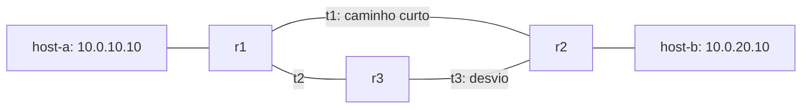

# Minha pequena internet

Trabalho semestral de Redes e Sistemas Distribuídos.

## Entrega 1 — Dois segmentos e um serviço

### Plano de endereçamento

A topologia utiliza duas sub-redes IPv4 independentes, ambas com prefixo `/24`:

- Segmento A: `10.0.10.0/24`
- Segmento B: `10.0.20.0/24`

Uma rede `/24` possui 24 bits para identificar a rede e 8 bits para endereços dentro da sub-rede. Assim, existem `2^8 = 256` endereços totais. Como o primeiro endereço identifica a rede e o último é reservado para broadcast, cada sub-rede possui `256 - 2 = 254` endereços utilizáveis por hosts.

#### Segmento A — `10.0.10.0/24`

| Máquina | Endereço IPv4 |
|---|---|
| host-a1 | `10.0.10.10` |
| host-a2 | `10.0.10.11` |
| srv-a | `10.0.10.20` |

- Endereço da rede: `10.0.10.0`
- Broadcast: `10.0.10.255`
- Faixa utilizável: `10.0.10.1` até `10.0.10.254`
- Total de hosts possíveis: 254

#### Segmento B — `10.0.20.0/24`

| Máquina | Endereço IPv4 |
|---|---|
| host-b1 | `10.0.20.10` |
| host-b2 | `10.0.20.11` |

- Endereço da rede: `10.0.20.0`
- Broadcast: `10.0.20.255`
- Faixa utilizável: `10.0.20.1` até `10.0.20.254`
- Total de hosts possíveis: 254

### Por que o segmento A não alcança o segmento B?

Os segmentos A e B pertencem a sub-redes diferentes. Na Entrega 1 não existe um roteador configurado para encaminhar pacotes entre essas duas redes.

Além disso, os hosts têm a rota padrão removida ao iniciar. Dessa forma, cada máquina conhece apenas a sua própria sub-rede diretamente conectada. A comunicação entre máquinas do mesmo segmento funciona normalmente, mas, quando uma máquina tenta enviar um pacote para a outra sub-rede, não existe rota disponível para esse destino e o sistema retorna `Network is unreachable`.

Isso prova que os dois segmentos estão funcionando individualmente e, ao mesmo tempo, permanecem isolados entre si.

### Testes da Entrega 1

Na Google Cloud Shell, a verificação pode ser executada com:

```bash
make up E=1
make verificar E=1
```

Depois que todas as provas estiverem verdes, as evidências são geradas com:

```bash
make evidencias E=1
```

## Entrega 3 — O serviço não pode cair

O diretório `e3-replicas/` usa a topologia e o verificador oficiais do
laboratório do professor. Um cliente no segmento A (`10.0.10.10`) acessa três
réplicas HTTP no segmento B através do roteador, com endereços
`10.0.10.254` e `10.0.20.254`.

| Réplica | Endereço | Resposta HTTP |
|---|---|---|
| replica1 | `10.0.20.21:8080` | `replica1` |
| replica2 | `10.0.20.22:8080` | `replica2` |
| replica3 | `10.0.20.23:8080` | `replica3` |

### Como o cliente mantém o serviço disponível

O `cliente.sh` tenta cada réplica em sequência. Cada tentativa tem limite
total de 1 segundo, incluindo a conexão e o recebimento da resposta. Se uma
tentativa falhar, o cliente passa à próxima, sem repetir indefinidamente.
As três tentativas têm um orçamento de rede de até 3 segundos, deixando
margem para terminar antes dos 5 segundos do contrato.

O cliente só imprime o nome que recebeu quando o `curl` termina com sucesso
e o corpo corresponde à réplica consultada. Erros HTTP, respostas vazias,
nomes incorretos e transferências incompletas não contam como sucesso.
Quando encontra uma resposta válida, termina com código 0. Quando nenhuma
réplica responde, imprime apenas `INDISPONIVEL` e termina com código 1.
Uma nova execução tenta as três novamente, permitindo recuperação sem
alterar o cliente.

### Réplica morta × partição de rede

O cliente não consegue distinguir com certeza uma réplica morta de uma
réplica particionada apenas pela ausência de resposta. Em `docker stop`, o
processo da réplica é encerrado. Em `docker network disconnect`, o processo
continua em execução, mas perdeu a comunicação com o cliente. Nos dois
casos, a requisição pode falhar ou atingir o limite de tempo.

Para este serviço de consulta, essa incerteza não impede o funcionamento:
o cliente precisa saber qual réplica respondeu, tenta as demais e avisa
quando nenhuma está alcançável. `INDISPONIVEL` significa indisponível para
este cliente, e não que todas as réplicas necessariamente morreram. Em um
serviço com escritas, a distinção exigiria mais cuidado, pois uma operação
poderia ter sido executada mesmo sem a resposta chegar; repeti-la poderia
duplicar seus efeitos.

### Testes e evidências

```bash
make up E=3
make verificar E=3
make evidencias E=3
python3 e3-replicas/testar-contrato.py
```

O verificador oficial cobre tudo no ar, uma réplica parada, duas paradas,
partição da última réplica e restauração. O teste complementar mede também
o código de saída e o tempo com precisão, cada réplica funcionando sozinha,
todas paradas e partição de uma réplica com outras disponíveis.

O GitHub Actions executa os testes com Docker e grava a saída oficial em
`e3-replicas/evidencias/verificacao.txt`, além das medições complementares
em `e3-replicas/evidencias/contrato.txt`. As evidências da Entrega 1 são
preservadas. Para reproduzir no Cloud Shell, use os comandos acima na
pasta deste repositório.

## Entrega 4 — A rota se refaz sozinha

O diretório `e4-roteamento/` usa a topologia de três roteadores do laboratório
oficial. Existem dois caminhos entre os segmentos A e B: o trânsito 1 liga r1
diretamente a r2; o desvio passa por r3, pelos trânsitos 2 e 3.



### Endereçamento e configuração

| Segmento | Rede | Endereços dos roteadores |
|---|---|---|
| A | `10.0.10.0/24` | r1: `10.0.10.254` |
| B | `10.0.20.0/24` | r2: `10.0.20.254` |
| Trânsito 1 | `10.0.30.0/24` | r1: `.11`; r2: `.12` |
| Trânsito 2 | `10.0.40.0/24` | r1: `.11`; r3: `.13` |
| Trânsito 3 | `10.0.50.0/24` | r2: `.12`; r3: `.13` |

Os hosts mantêm rotas para a rede oposta via seu roteador local. Quem escolhe
entre o caminho curto e o desvio são os roteadores. Neles, o script
`iniciar-roteador.sh` remove a rota padrão e inicia o BIRD em primeiro plano,
sem instalar as antigas rotas estáticas entre A e B. O encaminhamento IPv4 é
habilitado no compose.

Os identificadores do BIRD são únicos: r1 usa `10.0.10.254`, r2 usa
`10.0.20.254` e r3 usa `10.0.40.13`. No arquivo de r2, o identificador
`0.0.0.0` do enunciado foi corrigido para seu endereço no segmento B.

As configurações dos três roteadores têm os mesmos quatro componentes:

| Componente | Função |
|---|---|
| `protocol device` | Acompanha interfaces e mudanças no estado dos enlaces. |
| `protocol direct` | Inclui as redes diretamente conectadas na tabela do BIRD. |
| `protocol rip` | Troca rotas IPv4 com os vizinhos e escolhe caminhos pela métrica de saltos. |
| `protocol kernel` | Exporta as rotas selecionadas pelo BIRD para a tabela do Linux, usada no encaminhamento real. |

### O que muda quando o trânsito 1 cai

No estado normal, r1 chega a B pelo próximo salto `10.0.30.12`, diretamente em
r2. O desvio exige mais um roteador e perde pela métrica do RIP. Quando o
trânsito 1 é desconectado nas duas pontas, o caminho direto deixa de existir.
O RIP aprende/seleciona o caminho disponível via r3, e o próximo salto de r1
passa para `10.0.40.13`. No sentido inverso, r2 usa `10.0.50.13`.

Quando o trânsito 1 é reconectado, o caminho de menor custo volta a ser
preferido: r1 usa `10.0.30.12` e r2 usa `10.0.30.11`. O teste complementar
aguarda essa volta e confirma ping A→B e B→A em todos os estados.

O controle com rotas estáticas usa uma sobrescrita separada,
`docker-compose.estatico.yml`. Ele demonstra que a comunicação funciona antes
da falha, mas não migra para r3 quando o trânsito 1 cai. A execução normal
(`make up E=4`) usa somente RIP. Não há intervenção manual para inserir rotas
durante a prova dinâmica.

### Tempo de convergência medido

<!-- E4-RESULTADOS-INICIO -->
Medição em Docker real, em 2026-11-05T22:49:31.806909+00:00:

| Verificação | Resultado medido |
|---|---|
| Roteiro oficial: recuperação após queda das duas pontas de t1 | 29 s |
| Teste complementar: desvio confirmado e ping nos dois sentidos | 25.765 s |
| Teste complementar: volta ao caminho curto nos dois sentidos | 0.283 s |

Os resultados são de execuções distintas: o roteiro oficial mede em segundos
inteiros; o complementar usa relógio monotônico, consulta aproximadamente a cada
segundo e inclui as operações Docker. Os valores não são uma garantia de tempo
para outra máquina ou para outra fase dos temporizadores do RIP.

Commit testado: `dcadf511040cf97c08d49cc25800f4710af4aa22`.
[Execução e logs](https://github.com/luizf23-star/lab-redes/actions/runs/42124323897).
<!-- E4-RESULTADOS-FIM -->

### E numa rede com 50 roteadores?

O número total de roteadores não determina sozinho a convergência: também
importam o diâmetro da topologia, os caminhos alternativos, a detecção da
falha e a fase dos temporizadores. A informação se propaga entre vizinhos;
quanto mais etapas dependentes, mais pode demorar para todos terem uma visão
coerente. Não seria correto multiplicar o tempo deste laboratório por 50/3.

No RIPv2, as atualizações completas periódicas têm intervalo nominal de
30 segundos; atualizações disparadas por mudanças podem antecipar avisos.
Uma rota sem atualização expira após 180 segundos. Ao desconectar as DUAS
pontas, o experimento representa uma queda detectável do enlace; se só um
lado perder comunicação, o outro pode manter informações antigas até que a
falha seja detectada ou a rota expire. Portanto, 180 segundos é um
temporizador de expiração, não o tempo obrigatório de toda convergência.

Há ainda um limite fundamental: a métrica 16 representa destino inalcançável,
e caminhos válidos têm no máximo 15 saltos. Uma rede de 50 roteadores pode
usar RIP se as distâncias entre os destinos ficarem dentro desse limite;
uma cadeia de 50 roteadores não consegue oferecer alcance de ponta a ponta
por RIP. Em redes maiores, as atualizações periódicas, os estados temporariamente
inconsistentes e o problema de contagem até o infinito tornam o protocolo
menos adequado. Split horizon, poison reverse e atualizações disparadas
reduzem problemas, mas não eliminam todas as situações de convergência lenta.

### Reprodução e evidências

No Cloud Shell ou em Linux com Docker e o plugin Compose, a partir da raiz:

```bash
make up E=4
python3 e4-roteamento/testar-convergencia.py --aguardar
make verificar E=4
make evidencias E=4
python3 e4-roteamento/testar-convergencia.py
make down E=4
```

As entregas compartilham as sub-redes: o `make up` encerra as outras
topologias antes de iniciar a selecionada. Aguarde cada teste acabar antes de
iniciar outro, pois ambos desconectam o trânsito 1.

| Arquivo em `e4-roteamento/evidencias/` | O que registra |
|---|---|
| `verificacao.txt` | Saída integral do verificador oficial: estado normal, falha, desvio e restauração. |
| `controle-estatico.txt` | Falha esperada do experimento com rotas estáticas. |
| `complementar.txt` | Próximos saltos e tráfego nos dois sentidos, incluindo retorno ao caminho curto. |
| `convergencia.json` | Tempos medidos, rotas por estado, commit testado e URL da execução. |
| `ambiente.txt` | Versões do Docker, protocolos do BIRD e tabelas de rotas. |

O fluxo `.github/workflows/e4-evidencias.yml` executa o controle estático,
recria o laboratório com RIP, valida as configurações e executa os dois
verificadores com Docker real. Somente após sucesso grava as evidências e as
medições no Git. A falha esperada do controle estático é conferida
explicitamente e não é confundida com sucesso da solução dinâmica.

O `verificar.sh` é o original do professor, sem alterações. A base da E4 foi
obtida do commit `738b84f8412ab83320bc4aa90e45b07f96c8e5f1` do laboratório
oficial; as entregas anteriores deste repositório foram preservadas.

Referências:

- [Enunciado oficial da E4](https://github.com/LuizRMSilva1973/redes-lab/blob/738b84f8412ab83320bc4aa90e45b07f96c8e5f1/entregas/E4.md).
- [RFC 2453 — RIPv2](https://www.rfc-editor.org/rfc/rfc2453.html), especialmente seções 3.2, 3.4 e 3.8.
- [Trabalho semestral — Minha pequena internet](https://profluiz.mantovanitec.com/disciplinas/aulas/redes/trabalho.html).


## Entrega 5 — Captura e cartilha de Wi-Fi seguro

A E5 e independente da E4 e deve ser enviada em campo proprio do formulario da disciplina.

- Laboratorio isolado e codigo-fonte: [e5-seguranca/](e5-seguranca/)
- Token didatico vinculado ao responsavel: [token.txt](e5-seguranca/token.txt)
- Captura autenticada e PDF: o [GitHub Actions E5](.github/workflows/e5-evidencias.yml) gera `claro.pcap`, `cifrado.pcap`, `evidencias/verificacao.txt`, `evidencias/captura-http-real.png` e `cartilha.pdf` somente depois que o verificador oficial passa.
- Veja [instrucoes de entrega da E5](e5-seguranca/README.md) e [texto-base da cartilha](e5-seguranca/cartilha-texto.md).
- **Regra de seguranca:** capturas apenas entre contêineres do proprio laboratorio; nao capturar trafego de pessoas ou redes externas.
- **Extensao:** registros de apresentacao ao publico e revisao apos feedback dependem de atividades realizadas de verdade, fora da sala.

### Entregas independentes no formulario

| Envio | Evidencias e pasta |
|---|---|
| **E4 — Roteamento RIP** | [Guia de envio da E4](e4-roteamento/ENTREGA-4-ENVIO.md), [verificacao verde da E4](e4-roteamento/evidencias/verificacao.txt) |
| **E5 — Captura e Cartilha** | [Guia da E5](e5-seguranca/README.md), arquivos `claro.pcap`, `cifrado.pcap` e `cartilha.pdf` depois da geracao real |
